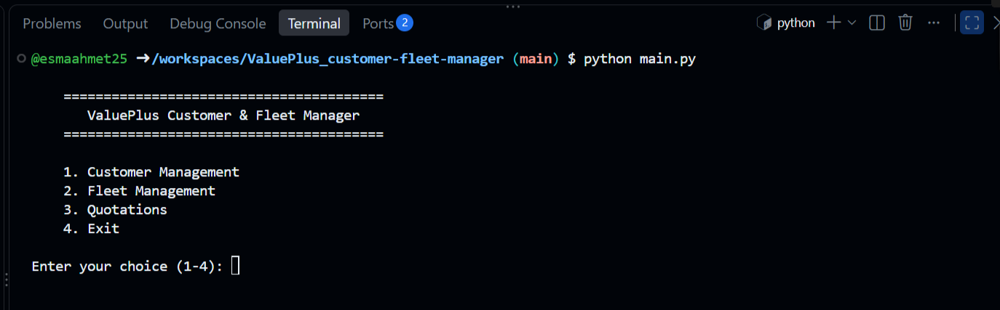
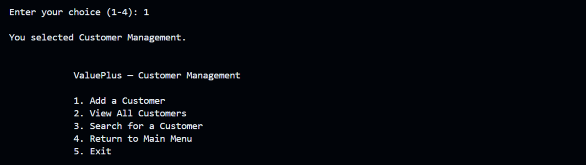
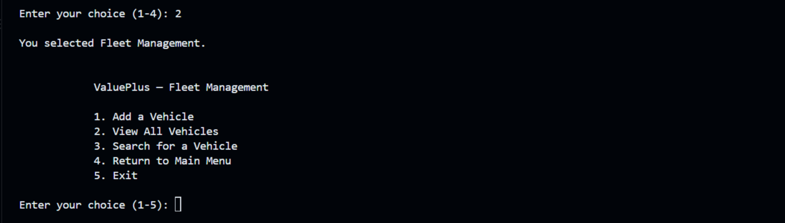

# ValuePlus Customer & Fleet Manager

A beginner-friendly Python command-line application for managing customer records, fleet information, and vehicle leasing quotations.

## About the Project

The **ValuePlus Customer & Fleet Manager** is an independent portfolio project inspired by common workflows in vehicle leasing and fleet management.

The goal is to build a simple application that helps organize customer information, track vehicle availability, search for suitable vehicles, and calculate estimated leasing costs.

This project is also part of my journey in developing practical Python programming skills by turning business requirements into a working application.

*This is an independent learning project. It is not official Value Plus software and is not affiliated with Value Plus KSA.*

## Features — Version 1

The first version includes the following implemented features:

- Customer Management: Add, view, and search customer records.

- Fleet Management: Add, view, and search vehicle records.

- Vehicle Availability: Track whether each vehicle is available or unavailable.

- Quotation Management: Create, view, and search quotations linked to existing customers and vehicles.

- Cost Calculation: Calculate estimated monthly costs and total contract values based on vehicle price, quantity, and contract duration.

- Data Storage: Save and load customer, vehicle, and quotation records using JSON files.

- Input Validation: Handle invalid inputs, duplicate customer information, unavailable vehicles, and missing records.

- Unique IDs: Generate sequential IDs for customers, vehicles, and quotations.

## Application Screenshots

### Main Menu


### Customer Management


### Fleet Management


### Quotation Management


## Technologies

- **Python** — application logic and business rules.
- **JSON** — local data storage.
- **Git and GitHub** — version control and project documentation.
- **Terminal / Command Line** — user interaction.

## Project Structure

```text
ValuePlus_customer-fleet-manager/

├── data/
│   ├── customers.json
│   ├── vehicles.json
│   └── quotations.json
├── tests/
│   ├── test_empty_data.py
│   ├── test_quotation_id.py
│   └── test_storage.py
├── customers.py
├── fleet.py
├── quotations.py
├── storage.py
├── main.py
├── README.md
├── LICENSE
└── .gitignore
```

The `data/` directory contains JSON files used to store customer, vehicle, and quotation records locally. If a data file is missing, the application loads an empty list and creates the file when records are saved.

- `main.py` — runs the application and displays the main menu.
- `customers.py` — handles customer-related operations.
- `fleet.py` — handles vehicle records, availability, and vehicle searches by ID.
- `quotations.py` — creates quotations and calculates estimated costs.
- `storage.py` — manages loading and saving JSON data.
- `data/` — stores customer, vehicle, and quotation records locally.


## How to Run

### Prerequisites

- Python 3.
- Git.

### Installation

1. Clone the repository:

   ```bash
   git clone https://github.com/esmaahmet25/ValuePlus_customer-fleet-manager.git
   ```

2. Navigate to the project directory:

   ```bash
   cd ValuePlus_customer-fleet-manager
   ```

3. Run the application:

   ```bash
   python main.py
   ```

No external Python packages are required for the current version.


## Example Workflow

1. Register a customer.
2. Add vehicles to the fleet.
3. View or search for registered customers and vehicles.
4. Select an existing customer and an available vehicle.
5. Enter the vehicle quantity and contract duration.
6. Generate a quotation with calculated monthly and contract totals.
7. Save the quotation and other records locally using JSON files.


## Learning Objectives

Through this project, I aim to practice:

- Functions, loops, conditionals, and dictionaries.
- Lists and structured data management.
- Input validation and error handling.
- Splitting a program into multiple Python modules.
- Reading and writing JSON files.
- Testing, debugging, and maintaining code.
- Using Git and GitHub to document development progress.

## Future Improvements

Possible future versions may include:

- A database using SQLite or PostgreSQL.
- Automated customer follow-up reminders.
- More detailed fleet and quotation reports.
- A web interface using Flask or FastAPI.
- API integrations and AI-powered customer support.

These are future ideas, not features currently included in Version 1.

## Project Status

**Version 1 — Completed**

The first version includes customer management, fleet management, quotation management, input validation, and JSON-based data persistence.

The application has undergone manual functional testing and code review.

Future versions will introduce object-oriented programming, database integration, APIs, and AI-powered automation.

## Disclaimer

This project uses fictional sample data and illustrative prices for educational purposes. It does not use Value Plus KSA's internal data, systems, or actual pricing.

## Author

Developed as part of my journey in Python programming, software development, and AI automation.
